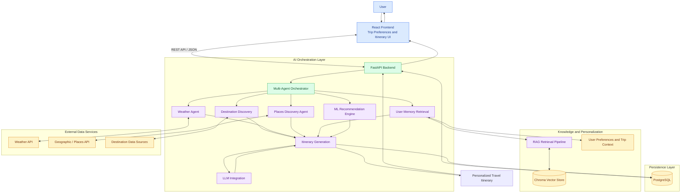

# VoyageMind AI — Autonomous Multi-Agent Travel Planning System

**An AI-powered travel planning platform that combines multi-agent orchestration, LLMs, Retrieval-Augmented Generation (RAG), personalized recommendations, real-time travel APIs, and PostgreSQL to generate context-aware travel itineraries.**

[](https://www.python.org/)
[](https://fastapi.tiangolo.com/)
[](https://react.dev/)
[](https://www.postgresql.org/)
[](https://www.trychroma.com/)
[](https://www.langchain.com/langgraph)

**Live Application:** [VoyageMind AI](https://voyage-mind-ai-cd8x.vercel.app)  
**Backend API:** [FastAPI on Render](https://voyagemind-ai-1.onrender.com)  
**Repository:** [Abhyang95/VoyageMind-AI](https://github.com/Abhyang95/VoyageMind-AI)

---

## Problem Statement

Traditional travel planning requires users to manually search for:

- Destinations
- Places and attractions
- Weather information
- Restaurants
- Activities
- Budget estimates
- Travel preferences
- Daily itineraries

This information is usually distributed across multiple platforms.

VoyageMind AI combines these tasks into a single intelligent travel-planning workflow that understands user preferences and generates personalized trip plans.

---

## Key Features
## System Architecture

VoyageMind AI follows a modular, multi-agent architecture that integrates large language models, Retrieval-Augmented Generation (RAG), machine learning recommendations, external APIs, and persistent storage to generate personalized travel itineraries.

The frontend collects trip requirements and communicates with the backend API. The backend coordinates specialized travel-planning components, retrieves relevant user preferences and contextual information, gathers external travel data, and generates a structured itinerary using an LLM-powered workflow.

### Architecture Diagram



### Architecture Components

| Component | Responsibility |
|---|---|
| React Frontend | Collects travel preferences and displays generated itineraries. |
| FastAPI Backend | Exposes API endpoints and coordinates communication between the frontend and backend services. |
| Multi-Agent Orchestrator | Coordinates specialized travel-planning components and combines their outputs. |
| LLM Integration | Generates contextual, personalized itinerary content. |
| RAG Pipeline | Retrieves relevant information from the vector knowledge store to support contextual responses. |
| User Memory | Uses available user preferences and trip context to personalize planning. |
| ML Recommendation Engine | Helps rank or recommend travel options based on the implemented recommendation logic. |
| External APIs | Provide live weather and geographic or place information, depending on provider availability. |
| Chroma Vector Store | Stores and retrieves vectorized knowledge for semantic search. |
| PostgreSQL | Persists supported application data, such as user information or trip records, according to the database schema. |

### End-to-End Workflow

1. **Preference collection:** The user enters the destination, dates, budget, interests, and other travel preferences.
2. **API request:** The React frontend sends the trip request to the FastAPI backend.
3. **Task orchestration:** The orchestrator coordinates the relevant travel-planning components.
4. **Context retrieval:** The system retrieves relevant knowledge and available user preferences through the RAG and memory components.
5. **External data enrichment:** The relevant components obtain weather and place information from external services.
6. **Recommendation:** The recommendation engine contributes suitable travel options.
7. **Itinerary generation:** The LLM uses the available trip context and component outputs to generate a personalized itinerary.
8. **Persistence and response:** Supported trip data is stored in PostgreSQL, and the generated itinerary is returned to the frontend.

### Design Principles

- **Modularity:** Specialized components separate travel-planning responsibilities.
- **Context-aware generation:** RAG and user memory can provide relevant context for itinerary generation.
- **External data integration:** Travel plans can incorporate information retrieved from connected services.
- **Persistent storage:** PostgreSQL supports durable storage of application data.
- **Extensibility:** Additional agents, recommendation strategies, and data providers can be integrated as the platform evolves.
### AI-Powered Trip Planning

Generate personalized travel itineraries using an LLM-powered planning workflow.

Users can provide:

- Destination
- Departure date
- Return date
- Trip duration
- Budget
- Currency
- Interests
- Walking preference
- Hotel preference
- Restaurant preference

---

### Multi-Agent Architecture

VoyageMind uses a multi-agent workflow to divide travel-planning tasks into specialized components.

The system includes components for:

- Destination discovery
- Weather information
- Place discovery
- User memory retrieval
- AI recommendations
- Itinerary generation

These components contribute information to the final travel-planning workflow.

---

### Real-Time Place Discovery

The Places workflow integrates with external geographic data sources to discover attractions based on selected interests.

Example interests include:

```text
Nature
Shopping
Adventure
Architecture
History
Museums
Nightlife